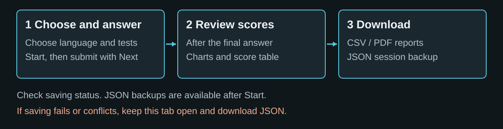
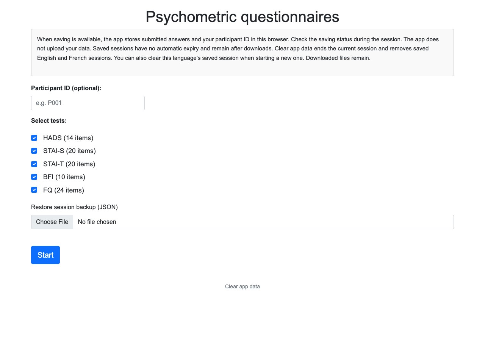
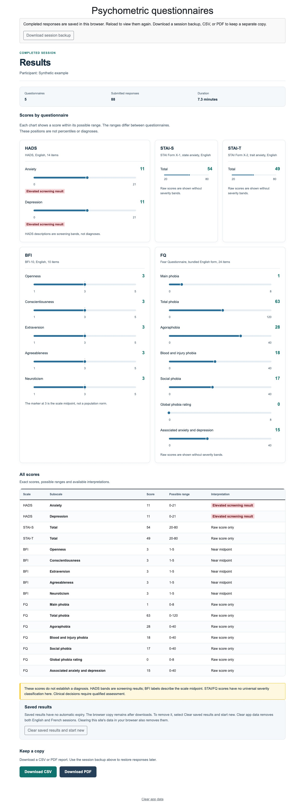

# Psychometric

Psychometric runs five questionnaires in English or French, with 88 items in total. Choose one or more questionnaires, answer each item, then view scores and download a CSV or PDF report. Scoring runs in the browser. Responses are not uploaded.



[Open in Figma / FigJam](https://www.figma.com/board/alZQw9y4qKnjlBXoksGf26) · [SVG diagram](docs/design/pipeline.svg) · [Diagram source](docs/design/pipeline.mmd)

Follow the top row to use the app. Saving and recovery run alongside it. The bottom row shows how design changes reach GitHub Pages after both verification jobs pass.

## Run the app

Use the [hosted app](https://urmeo.github.io/psychometric/), or download this repository and open `index.html`. No installation, build or server is required to use it. Automatic saving depends on browser support and storage access; check the saving status before closing the tab.

1. Choose a language and the questionnaires to complete. The participant ID is optional; use a code rather than a name.
2. Submit each answer with **Next**. An option or description still being edited has not been submitted or saved.
3. View the scores and download a report. Use a JSON session backup if you need to restore the session later.

Scores do not establish a diagnosis. HADS provides screening bands; BFI-10 describes traits relative to the scale midpoint. STAI and FQ report raw scores without severity bands.

## Questionnaires

| Instrument | Items | Output |
|:-----------|------:|:-------|
| HADS | 14 | Anxiety and depression: 0–21 each, with screening bands |
| STAI-S | 20 | State anxiety: 20–80 |
| STAI-T | 20 | Trait anxiety: 20–80 |
| BFI-10 | 10 | Five trait means: 1–5 each |
| FQ | 24 | Total phobia: 0–120; three phobia subscales and associated anxiety/depression: 0–40 each; main and global phobia ratings: 0–8 each |

English STAI uses Forms X-1/X-2. French STAI uses Forms Y-1/Y-2, with different scoring keys. The French BFI-10 follows [Courtois et al. (2020)](https://www.em-consulte.com/article/1361431). The [instrument rights and source notes](NOTICE.md) cover permissions and the FQ scoring convention.

The results page shows each score on its own possible range, followed by a table of exact values and interpretations. Chart positions are not percentiles.

CSV and PDF reports include submitted responses, optional FQ descriptions, scores, questionnaire forms, revision and timestamps. PDF cannot represent every character; use the UTF-8 CSV to retain unsupported characters.

## Saving and recovery

The app saves submitted answers in this browser and can reopen unfinished sessions or completed results after a reload. A **saved** status confirms that the response write was read back and its coordination record committed. Automatic saving requires browser locks, IndexedDB and hashing support. If saving fails, is unavailable or conflicts with another tab, keep the tab open and download a JSON backup before leaving or reloading. Starting a download does not confirm that a file was saved.

Each language has one browser save. If another tab changes that save, this tab stops replacing it and keeps its own answers available for backup. Clear controls also prevent older tabs from recreating cleared responses, including answers that could not be saved.

JSON backups contain the participant ID and submitted responses. They can restore unfinished sessions or completed results from setup, using the same language and questionnaire configuration. Restoration validates the backup and does not replace an existing browser save. Resume, view or explicitly clear that save first. CSV and PDF reports cannot be restored as sessions.

An unreadable or incompatible save remains unchanged. Download its original data before clearing it. The matching questionnaire configuration or a corrected device clock may allow recovery; damaged data may need repair. If the device clock moves backwards during a session, submission pauses until the clock is corrected.

Browser saves contain sensitive responses and have no automatic expiry. Downloads leave the browser copy saved. **Clear app data** ends the current session and removes both language saves. Other clear controls remove the displayed language's save. Failed or unverified deletion is reported. Clearing responses leaves downloaded files and coordination metadata, which contains no participant IDs or responses. Clearing this site's data in browser settings removes its browser storage. Browsers can also clear storage independently; keep a separate backup when the data matters.




[View the French results example](outputs/results-fr.jpg).

## Development

The app uses HTML, CSS, vanilla JavaScript, Bootstrap and jsPDF. Libraries are bundled in `assets/vendor/`; using the app does not require npm. Node.js 22.12 or later is required for verification:

```sh
npm ci
npm run check:vendor
npm test
npm audit --audit-level=high
```

Puppeteer runs browser tests for scoring, persistence, recovery and actual CSV/PDF downloads in both languages. The vendor check compares bundled jsPDF with its locked npm package. See [CONTRIBUTING.md](CONTRIBUTING.md) for change and review guidance.

GitHub Actions checks Node.js 22 and 24 before deploying `main` to GitHub Pages.

Language pages live in `en/` and `fr/`. Application code, styles and translations are in `assets/`. The `docs/` directory contains source instrument PDFs; `scripts/` and `tests/` contain verification code.

## License and references

[MIT](LICENSE) covers the software, not questionnaire rights. STAI and HADS require permission; see [NOTICE.md](NOTICE.md) before use.

| Instrument | Source |
|---|---|
| HADS | [Snaith (2003)](https://link.springer.com/article/10.1186/1477-7525-1-29) |
| STAI | [Mind Garden, instrument and forms](https://www.mindgarden.com/145-state-trait-anxiety-inventory-for-adults) |
| BFI-10 | [Rammstedt & John (2007)](https://www.sciencedirect.com/science/article/pii/S0092656606000195) |
| FQ | [Marks & Mathews (1979)](https://www.sciencedirect.com/science/article/pii/000579677990041X) |
