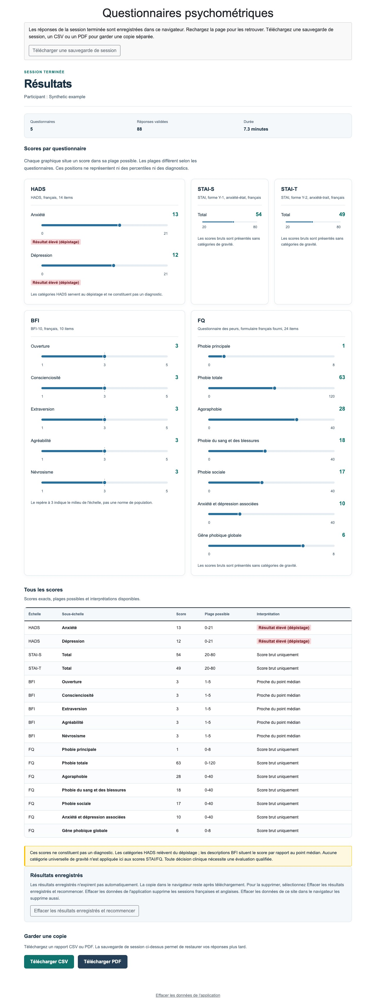

# Psychometric

Five questionnaires in English or French, with 88 items in total. Submit responses, review score charts and tables, and download reports. Scoring runs in the browser; responses are not uploaded.

**Keywords:** JavaScript · Questionnaire scoring · IndexedDB · Puppeteer

## Pipeline and images


[Full-size diagram](docs/design/pipeline.svg) · [Edit in Figma](https://www.figma.com/design/2fRPk2Ky5TkaEtweHzj5Wz?node-id=6-2)

[Diagram source](docs/design/pipeline.mmd)


## Run

[Open the hosted app](https://urmeo.github.io/psychometric/). For a local server, use Node.js 22.12 or later:

```bash
git clone https://github.com/urmeo/psychometric.git
cd psychometric
node -e 'require("./scripts/test-server")().then(({ origin }) => console.log(origin))'
```

Open the printed address. Choose a language and questionnaires; the participant ID is optional. Select **Next** to submit each response. A choice or description still being edited remains unsaved. Download CSV or PDF reports for review, or a JSON backup for later restoration.

<details>
<summary>Saving and recovery</summary>

Saving requires browser locks, IndexedDB and hashing support. A saved status confirms that the response write was read back and its coordination record committed. If saving fails, is unavailable or conflicts with another tab, keep the tab open and download a JSON backup before leaving. Requesting a download does not confirm that the file was saved.

Each language has one save. JSON backups restore submitted responses in the same language and questionnaire configuration; imports cannot replace an existing save. CSV and PDF reports cannot restore sessions. Unreadable saves remain unchanged for original-data backup. A matching configuration or corrected device clock may permit recovery; damaged data may need repair. Submission pauses if the clock moves backwards.

Saves contain sensitive responses and have no automatic expiry. Completion and downloads retain them. **Clear app data** ends the session and removes both language saves; other clear controls remove the displayed language's save. Failed or unverified deletion is reported. Downloaded files and response-free coordination metadata remain. Clearing prevents older tabs from recreating responses. Browser settings can remove all site storage; browsers may also clear it independently. Keep a separate backup when the data matters.

</details>

## Results

A full session produces **16 scores from 88 responses**. Charts show each score within its possible range; positions are not percentiles. Scores do not establish a diagnosis.

| Questionnaire | Items | Scores and possible ranges |
|---|---:|---|
| HADS | 14 | Anxiety and depression: 0–21 each, with screening bands |
| STAI-S | 20 | State anxiety: 20–80, raw score |
| STAI-T | 20 | Trait anxiety: 20–80, raw score |
| BFI-10 | 10 | Five trait means: 1–5 each, relative to the scale midpoint |
| FQ | 24 | Total phobia: 0–120; three phobia subscales and anxiety/depression: 0–40 each; main and global phobia: 0–8 each |

These screenshots use synthetic responses.

<details>
<summary>English charts and score table</summary>


</details>

<details>
<summary>French charts and score table</summary>



</details>

English STAI uses Forms X-1/X-2; French STAI uses Y-1/Y-2 with different scoring keys. French BFI-10 follows [Courtois et al. (2020)](https://www.em-consulte.com/article/1361431). Source forms are in [English](docs/english/) and [French](docs/french/).

The English FQ note lists six anxiety/depression items but gives a 0–40 range. Scoring uses five fixed items; optional other feelings stay separate.

CSV and PDF reports include submitted responses, optional FQ descriptions, scores, forms, revision and timestamps. PDF cannot represent every character; UTF-8 CSV retains unsupported characters.

## Tech Stack

| Purpose | Tools |
|---|---|
| Interface | HTML, CSS, JavaScript, Bootstrap 5.1.3 |
| Browser saving | localStorage, IndexedDB, Web Locks, SHA-256 through Web Crypto |
| Reports and backups | jsPDF 4.2.1, UTF-8 CSV, JSON |
| Verification | Node.js 22.12 or later, Puppeteer 25.2.0 |

Run the vendor check and browser tests from the repository root:

```bash
npm install --prefix . --no-save --package-lock=false puppeteer@25.2.0 jspdf@4.2.1
node scripts/check-vendor.js
node scripts/run-tests.js
```

Tests cover scoring, persistence, recovery and actual CSV/PDF downloads in both languages. Bundled libraries retain their original MIT license headers. After checks pass, run `node scripts/prepare-site.js` and manually publish `_site/` to a static host. Keep dependencies, generated files and response downloads out of source commits.

## Roadmap

- [ ] Verify saving, restoration and competing tabs in Firefox and Safari.
- [ ] Add PDF fonts for characters the current export cannot render.
- [ ] Reconcile the English FQ source-note discrepancy before revising its scoring key.

## References

1. Snaith (2003). [The Hospital Anxiety and Depression Scale](https://link.springer.com/article/10.1186/1477-7525-1-29).
2. Mind Garden. [State-Trait Anxiety Inventory: forms and permissions](https://www.mindgarden.com/145-state-trait-anxiety-inventory-for-adults).
3. Rammstedt & John (2007). [The ten-item Big Five Inventory](https://www.sciencedirect.com/science/article/pii/S0092656606000195).
4. Marks & Mathews (1979). [The Fear Questionnaire](https://www.sciencedirect.com/science/article/pii/000579677990041X).

## License

[MIT](LICENSE) covers the application code. Questionnaire rights are separate: obtain [STAI](https://www.mindgarden.com/145-state-trait-anxiety-inventory-for-adults) and [HADS](https://www.gl-assessment.co.uk/products/hospital-anxiety-depression-scale/) permission, follow the [BFI-10 research terms](https://www.ocf.berkeley.edu/~johnlab/bfi.html), and confirm FQ permission for the intended use.
