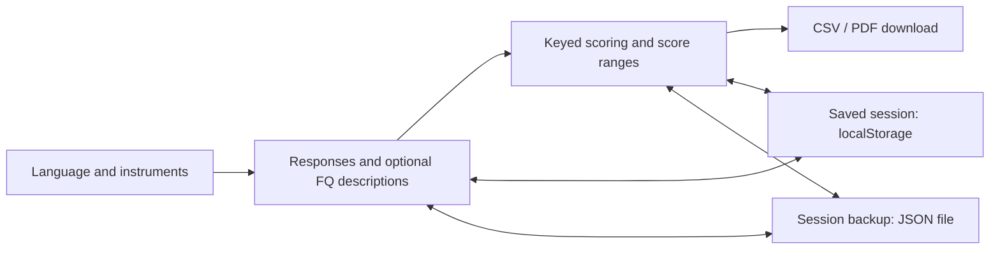

# Psychometric

**Psychometrics · Bilingual · Scoring · Export**

## Overview

English/French questionnaires: **5 instruments, 88 items**. [Open app](https://urmeo.github.io/psychometric/), or open `index.html` locally. No build or server.

### Data flow



## Instruments

| Instrument | Items | Output |
|:-----------|------:|:-------|
| HADS | 14 | Anxiety/depression: **0–21 each**, screening bands |
| STAI-S | 20 | State anxiety: **20–80**, raw score |
| STAI-T | 20 | Trait anxiety: **20–80**, raw score |
| BFI-10 | 10 | Five trait means: **1–5 each**, descriptive |
| FQ | 24 | Total phobia: **0–120**; three phobia subscales and associated anxiety/depression: **0–40 each**; main/global phobia: **0–8 each** |

STAI: English **Form X-1/X-2**, French **Form Y-1/Y-2**; keys differ. French BFI-10: [Courtois et al. (2020)](https://www.em-consulte.com/article/1361431).

## Features

- Choose instrument combinations.
- Resume saved progress or reopen completed results after reloading, with visible saving, saved, failure and tab-conflict status. Responses are submitted with Next; an option or description still being edited is not saved progress.
- In-progress and completed sessions remain saved in this browser until explicitly cleared, with no automatic expiry. CSV, PDF and JSON downloads leave the browser copy saved.
- Saved sessions that cannot be validated remain in the browser unchanged, including unfinished sessions, older questionnaire configurations, timestamps affected by a device clock correction, and damaged JSON. Download their original data before explicitly clearing them. A matching language and questionnaire configuration, or a corrected clock, may allow recovery; damaged data may need repair.
- Download a JSON session backup during an unfinished or completed session, then restore it from setup using the same language and questionnaire configuration. Restoration validates the session and does not replace an existing browser save; resume it, view its results or explicitly clear that save first.
- Check for a competing saved revision before writing. A conflicting tab keeps its answers available for backup and stops replacing the browser save.
- Clear app data ends the session and removes both language saves; a failure to delete or verify deletion is reported. When completed results are found, Clear saved results and start new clears that language's save and returns to setup; the other language's save remains.
- Clearing also updates a small coordination marker for each affected language, including when no responses could be saved. Other tabs check this marker before writing so an old memory-only session cannot recreate cleared data. These markers contain no participant IDs or responses.
- CSV/PDF: responses, descriptions, scores, forms, revision, timestamps.

Unsupported PDF characters export intact as UTF-8 CSV.


## Tech stack

| Layer | Tools |
|:------|:------|
| Interface | HTML, CSS, Bootstrap 5 |
| Scoring and storage | Vanilla JavaScript, localStorage |
| Downloads | CSV/Blob, jsPDF |
| Checks | Node.js, Puppeteer |

## Files

- `en/` and `fr/`: language entry pages.
- `assets/`: application code, styles, translations and bundled libraries.
- `docs/`: instrument references.
- `outputs/`: interface screenshots.
- `scripts/` and `tests/`: verification.

## Verify

Node **22.12+**.

```sh
npm ci
npm run check:vendor
npm test
```

To check persistence in the browser, submit an answer with Next and confirm the saved status. Block storage writes and submit another answer: a failure status should appear with retry and JSON backup controls. Restore that backup on the same language page after explicitly clearing any existing save. Open the same saved session in two tabs, submit in one and then the other, and confirm the second tab reports a conflict while the first tab's saved revision remains intact. If safe automatic saving is unavailable, confirm that the status directs the participant to keep the tab open and download a backup.

Complete a session and confirm that all completed responses are saved. Reload and select View saved results to reopen the same results; download CSV, PDF or JSON and reload again to verify that the browser copy remains. A completed JSON backup should reopen results after restoration. Clear saved results and start new should remove only the current language's saved results; Clear app data should remove both language saves. If the final save fails or conflicts, completed responses should remain available in the open tab for retry or download, and the status must not claim they are saved.

## Limits

1. No diagnosis: HADS screens, BFI describes, STAI/FQ report raw scores.
2. Use coded IDs. In-progress and completed browser saves and exports contain sensitive responses. Browser saves have no automatic expiry and remain after export until explicitly cleared, or until browser storage is cleared. Clearing saves leaves downloaded files.
3. [MIT](LICENSE) covers software only. STAI/HADS require permission; see [instrument rights](NOTICE.md).
4. Browser storage can fail or be cleared. Only a confirmed saved status establishes that the latest submitted answers were read back from this browser's storage. Keep a JSON backup before closing or reloading a tab when saving fails, conflicts, or is unavailable. Backups contain the participant ID and submitted responses and are separate from scored CSV/PDF reports.

## References

| Instrument | Source |
|---|---|
| HADS | [Snaith (2003)](https://link.springer.com/article/10.1186/1477-7525-1-29) |
| STAI | [Mind Garden, instrument and forms](https://www.mindgarden.com/145-state-trait-anxiety-inventory-for-adults) |
| BFI-10 | [Rammstedt & John (2007)](https://www.sciencedirect.com/science/article/pii/S0092656606000195) |
| FQ | [Marks & Mathews (1979)](https://www.sciencedirect.com/science/article/pii/000579677990041X) |
